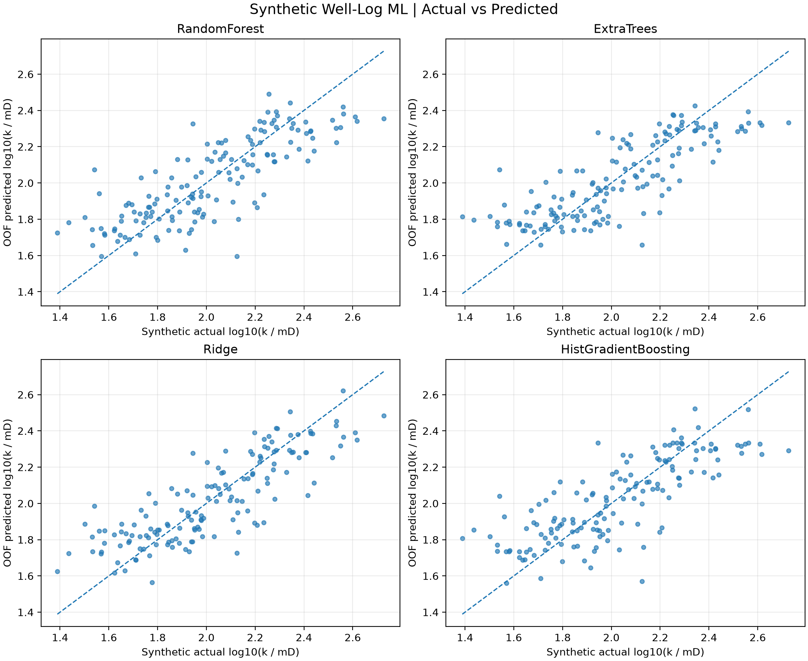
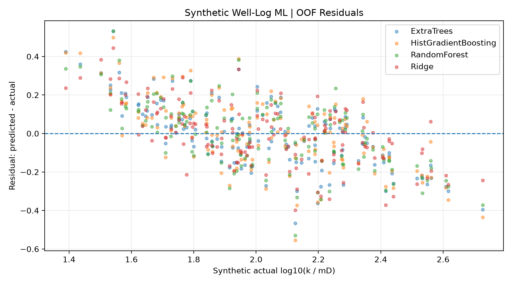
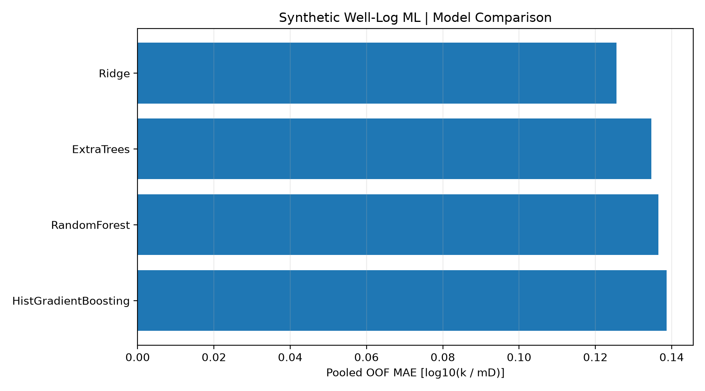

# Well-Log ML for Subsurface Characterization

A reproducible Python research workflow for evaluating machine-learning methods on depth-ordered subsurface observations.

The project explores how conventional well logs and laboratory core measurements can support data-driven petrophysical interpretation, with particular attention to validation design, prediction uncertainty, and limitations of historical datasets.

## Research objectives

- Estimate rock permeability using conventional well-log attributes.
- Compare linear and nonlinear regression models.
- Evaluate generalization across held-out depth intervals.
- Investigate systematic prediction errors.
- Demonstrate a transparent workflow for legacy subsurface data analysis.

## Research context

A separate experimental investigation used 325 paired core–log observations from one anonymized well.

The evaluated predictors included:

- Gamma ray (GR)
- Sonic transit time (DT)
- Resistivity (RT)

The target was logarithmic permeability, expressed as log10(k / mD).

The experimental investigation used depth-blocked validation and compared several regression approaches.

### Preliminary experimental finding

Random Forest achieved an approximate pooled out-of-fold MAE of 0.615 log10 permeability units.

Prediction errors were not uniform across permeability regimes. Very low permeability tended to be overpredicted, while high permeability tended to be underpredicted.

These findings are preliminary and are not reproduced by the public synthetic demonstration.

## Public reproducibility workflow

The public repository includes an executable demonstration using entirely synthetic observations.

### Validation strategy

- Five outer depth-blocked folds
- Three inner depth-blocked folds for hyperparameter selection
- Training-only preprocessing using scikit-learn pipelines
- Out-of-fold predictions
- Fold-level and pooled evaluation metrics

### Models

- Random Forest
- Extra Trees
- Ridge Regression
- Histogram-Based Gradient Boosting

The public demonstration uses compact parameter grids intended to illustrate the methodology rather than reproduce the original experimental tuning configuration.

## Synthetic demonstration results

The synthetic dataset contains 150 artificial observations.

| Model | Pooled OOF MAE | Pooled OOF RMSE |
|---|---:|---:|
| Ridge | 0.125506 | 0.158550 |
| Extra Trees | 0.134720 | 0.169115 |
| Random Forest | 0.136535 | 0.169676 |
| HistGradientBoosting | 0.138722 | 0.177463 |

All metrics are calculated in log10 permeability units.

These synthetic results must not be interpreted as performance estimates on real geological datasets.

## Figures

### Actual versus predicted



### Residual analysis



### Model comparison



## Repository structure

```text
well-log-ml-subsurface-characterization/
├── README.md
├── requirements.txt
├── .gitignore
├── src/
│   ├── depth_blocked_validation.py
│   ├── nested_validation.py
│   └── demo_nested_validation.py
├── tests/
│   └── test_validation.py
└── results/
    └── synthetic_demo/
        ├── actual_vs_predicted.png
        ├── residuals.png
        ├── model_comparison.png
        ├── fold_metrics.csv
        ├── model_comparison.csv
        └── oof_predictions.csv
```

## Installation

Create and activate a Python virtual environment, then install dependencies:

```bash
python -m pip install -r requirements.txt
```

## Run the synthetic demonstration

From the repository root:

```bash
python -m src.demo_nested_validation
```

The demonstration regenerates synthetic predictions, model metrics, and figures in:

`results/synthetic_demo/`

## Run automated tests

```bash
python -m unittest discover -s tests -v
```

## Methodological limitations

- The experimental investigation contains data from only one well.
- Depth-blocked validation is not equivalent to independent-well validation.
- Nearby depth intervals may remain correlated across training and test boundaries.
- The public demonstration uses synthetic rather than measured geological observations.
- Synthetic performance does not establish real-world predictive accuracy.
- Additional independent-well validation is required to assess transferability.

## Data confidentiality

Original well logs, core measurements, sample identifiers, original depths, geological provenance, and confidential mappings are not publicly distributed.

The public repository contains code, synthetic examples, and non-identifying aggregate research findings only.

## Research status

The public nested-validation demonstration and initial automated tests are operational.

Further work may include buffered depth validation, uncertainty analysis, permeability-regime diagnostics, and independent-well testing where suitable datasets are available.
